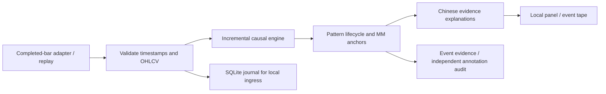

<div align="center">
<h1>Price Action Lens</h1>
<p>Causal chart observations. Explicit scenarios. Explanations you can audit.</p>


**English** · [简体中文](README.zh-CN.md)

[Overview](#overview) · [Quick start](#quick-start) · [Architecture](#architecture) · [Evidence](#verification-and-limits) · [Contribute](#contributing)
</div>

## Overview
An experimental Python extension of [AI Agent Lens](https://github.com/roan-maverick/tradingview-indicator-for-ai-agents). It processes completed bars sequentially, identifies an explicit research subset of Brooks-inspired price-action structures, and emits Chinese explanations with evidence, invalidation and measured-move anchors. It does **not** reproduce all Brooks patterns, place orders or supply market data by itself.

Upstream Pine and its license are preserved. See [original README](docs/UPSTREAM_README.md), [source review](docs/research/source_audit.md) and [honest coverage matrix](docs/COVERAGE.md). Our thresholds are engineering approximations, not official Brooks algorithms.

## Capabilities
- Causal double-top/bottom candidate and strict neckline-confirmation states; delayed pivots are never backdated as signals.
- Inside/outside observations, heuristic range breakout and context; explicit measured-move projections.
- Same incremental engine in replay and authenticated ingestion, SQLite restart recovery, stale-input status and a local chart/explanation panel.
- 44 source-grounded knowledge cards; event-level concept links, counterexamples and Chinese uncertainty explanations.
- ii/ioi, microchannels, separate gap types, EMA return, tight-range/barbwire, surprise/climax candidates and frozen breakout follow-through observations. H1/H2 and wedge lifecycle remain explicit approximations.
- Observation-first audit: event-time OHLC evidence, separately labeled future paths and calendar-selected manual-review samples. No invented accuracy figures.
- No invented win probability: `probability` is null. No API keys or external LLM needed for explanations.

## Quick start
Python 3.11+; standard library only. Run from the repository root.

```bash
python -m unittest discover -s tests -v
python -m pa_lens replay examples/pa/synthetic_double_bottom.jsonl --out local_data/demo
python -m pa_lens mm --a 100 --b 110 --c 105
```
The example is synthetic, not SOXL data or evidence of trading performance. Replay produces an event tape and a JSON report. Raw third-party market data is not redistributed.

### Local ingestion and panel
Set `PA_LENS_TOKEN` to your own random secret of at least 16 characters in your environment, then:

```bash
python -m pa_lens serve --db local_data/lens.sqlite3 --port 8080
```
Open `http://127.0.0.1:8080/`; enter the token in the panel (kept only in page memory). Submit completed bars:

```bash
curl -X POST http://127.0.0.1:8080/bar \
  -H "Authorization: Bearer $PA_LENS_TOKEN" -H 'Content-Type: application/json' \
  --data '{"symbol":"SOXL","timeframe":"1","time":"2026-11-17T14:31:00Z","open":50.5,"high":50.8,"low":50.1,"close":50.4,"volume":1000,"source":"example"}'
```
That request is an **illustrative historical bar**, not a live subscription. Canonical `time` is **bar CLOSE** time. `/webhook` accepts upstream `ai-agent-lens/v1` packet shape with the same Bearer authentication. TradingView cannot directly set that header. An explicit opt-in, separate query-secret endpoint is now available; see [live adapter / ingress](docs/LIVE_ADAPTER.md). No HTTPS relay is deployed. Never expose this HTTP development server directly to the Internet. `/health` and `/snapshot` require authentication. A healthy receiver or a RECENT timestamp does not establish a verified live feed.

### Observation audit
```bash
python -m pa_lens.audit YOUR_SOXL.csv --open-time-minutes 1 --out local_data/observation-audit
python knowledge/kb.py search "双底"
```
Audit products include private bar evidence and posthoc paths; keep them out of public git. Human annotation fields start blank, so precision/recall and insight accuracy remain unknown. November 17 is a known case, not a blind test. `evaluate` is only a separate legacy hypothetical-policy experiment.

### Display noise control
The panel defaults to structural changes: priority 3, 15-minute same-family/status/direction cooldown, and one group per closed bar. Raw observations are retained. For candidates, start with `--display-min-priority 2`; use `--display-cooldown-minutes 0` to disable suppression. These are display preferences, not confidence or accuracy scores. Changed settings require a new journal database so historical display state is not silently rewritten.

### Historical data
Replay accepts canonical JSONL/CSV or the documented Alpaca-export format (`timestamp` = bar OPEN, converted by +1 minute; `feed` retained in source identity). Inputs must be chronological and a single stream. Missing/invalid input is rejected or explicitly flagged, never silently sorted or filled.

### Optional completed-bar provider adapter
An Alpaca REST adapter and a saved-connector import bridge are implemented: see [connection instructions](docs/LIVE_ADAPTER.md). Actual bounded IEX closed-bar collection is documented in [live validation](docs/reports/LIVE_CONNECTOR_VALIDATION.md); recent SIP was denied. No autonomous deployment or uptime is claimed. Nine more conceptual subsets now include MTR development, final-flag candidates and completed 5-minute aggregates, not complete discretionary recognition: see [exact definitions](docs/STRUCTURES.md).

## Architecture


| Path | Responsibility |
|---|---|
| `pa_lens/core.py` | Bars, config, causal rules, projections |
| `pa_lens/service.py` | Authenticated ingestion, journal, health |
| `pa_lens/dashboard.html` | Local chart and evidence panel |
| `pa_lens/replay.py` | Loading and replay; separate legacy policy experiment |
| `pa_lens/observations.py` / `advanced.py` | Closed-bar observations and causal structure lifecycle |
| `pa_lens/explanations.py` / `knowledge/` | Source-grounded explanations, limitations and concept registry |
| `pa_lens/audit.py` | Observation audit and blank independent annotation templates |
| `tests/` | Causality, timing, lifecycle, cost and API regression tests |
| `docs/research/` | Source evidence and design boundaries |
| `docs/reports/` | Reproducible validation results and limitations |
| `ai-agent-lens.pine` | Unmodified upstream TradingView indicator |

## Extension guide
Add a source-grounded rule card first: definition, context, first-observable time, engineering thresholds, counterexamples and expected tests. Then add failing synthetic tests, implement incrementally, verify prefix invariance and update the coverage matrix. Keep overlapping labels linked to shared evidence instead of multiplying confidence. Do not copy code with incompatible licenses or future-looking behavior.

## Verification and limits
See the [observation audit protocol](docs/AUDIT_PROTOCOL.md) and [coverage](docs/COVERAGE.md) and [v0.4 results](docs/reports/V04_VALIDATION.md) ([historical v0.3](docs/reports/OBSERVATION_VALIDATION.md)). The older [validation report](docs/reports/VALIDATION.md) is a historical v0.1 policy experiment, not current observation accuracy. Passing tests and subsequent price direction are not independent pattern ground truth.

| Claim | Boundary |
|---|---|
| Causal rules | Confirmed pivots need future right-side bars before publication, never before |
| Real-time capable ingestion | Bounded actual IEX collection; no continuously deployed feed or uptime claim |
| November 17 SOXL | Previously inspected known case, **not blind out-of-sample** |
| Three-month SOXL | 66 sessions of retrospective observation replay; calendar samples await independent labels |
| Costs | Scenario assumptions unless historical quotes/actual executions available |
| Data adjustments | Connector adjustment setting may be unverified; see provenance |
| Pattern coverage | Partial, explicit heuristics; full MTR and subjective families still deferred |

## Contributing
Tests first, explicit source/licensing notes, negative examples and realistic data-quality handling. Do not commit credentials, raw restricted market data or unsupported performance claims. No automatic orders or financial account access in this project.

## License and disclaimer
MIT; upstream copyright remains in [LICENSE](LICENSE). Independent research software, not affiliated with Al Brooks, Brooks Trading Course, TradingView, Alpaca or Robinhood. Educational use only; signals may be wrong, and backtests are hypothetical. No investment advice or profitability guarantee.
