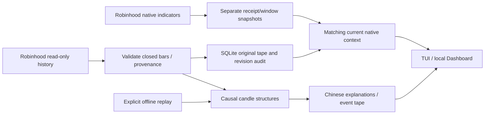

<div align="center">
<h1>Price Action Lens</h1>
<p>Causal chart observations. Native indicator context. Explanations you can audit.</p>


**English** · [简体中文](README.zh-CN.md)

[Overview](#overview) · [Quick start](#quick-start) · [Indicators](#native-indicators-and-price-structures) · [Dashboard](#replay-and-dashboard) · [Architecture](#architecture) · [Evidence](#verification-and-limits)
</div>

## Overview
A read-only **Robinhood MCP market observer**, extended from [AI Agent Lens](https://github.com/roan-maverick/tradingview-indicator-for-ai-agents). It processes completed candles sequentially, identifies a research subset of Brooks-inspired price-action structures, and explains observations in Chinese with evidence and uncertainty.

- **Terminal monitor:** Market / Native Indicators / Price Action / Data Quality panels, with a New York clock and explicit freshness.
- **Native-first context:** matching Robinhood EMA20/RSI14 for current interpretation; unavailable means unavailable, **never silent local fallback**.
- **Price structures:** double tops/bottoms, neckline confirmation, measured moves, inside/outside bars, breakout observations and documented heuristic lifecycle rules.
- **Replay and inspection:** causal event tape, restartable SQLite journals, chart hover and historical event focus.
- **44 source-grounded knowledge cards**, not 44 fully implemented detectors. No invented win probabilities: `probability=null`.

This is not an order executor, a complete Brooks-course implementation, or a verified profitable strategy. The code allowlist contains only equity history, quotes and technical-indicator reads. No account/order tools, credential copying or automatic alternate data source. Upstream Pine and MIT notices are preserved; see the [original README](docs/UPSTREAM_README.md), [research audit](docs/research/source_audit.md) and [coverage matrix](docs/COVERAGE.md).

## Quick start
### 1. Prepare the environment
Python **3.11+**; run from the repository root. A virtual environment avoids mixing dependencies with system Python.

```bash
python3 -m venv .venv
source .venv/bin/activate
python -m pip install -r requirements.txt
python -m unittest discover -s tests -v
```

Live reads additionally require:
1. A working `codex` executable and an **already authorized official Robinhood MCP connection**.
2. An existing compatible [Robinhood trading infra](https://github.com/GordonBai/robinhood-trading-infra) installation. This adapter expects `src/trading_execution/transport.py` exposing `CodexMarketTransport`; it does not install infra or complete login for you.
3. Its path, supplied in the wizard or through `--infra-root`. For examples below:

```bash
export RH_INFRA="$HOME/robinhood-trading-infra"
```

Offline synthetic replay needs no Robinhood authorization. [Provider contract and supported setup](docs/ROBINHOOD.md).

### 2. Start the guided monitor
```bash
python -m pa_lens wizard
```

On macOS, you can instead double-click [`Start-Monitor.command`](Start-Monitor.command). It selects an existing interpreter; it does not install anything. The wizard asks for stocks, candle period, session, polling schedule, finite/infinite duration, quality policy, infra location and a **new** journal, then previews the command for confirmation.

Defaults: **NVDA · 5m · regular · 30 seconds · 10 rounds · strict quality**. Enter `y` explicitly to explore UNKNOWN data. `q`, EOF or Ctrl-C cancels setup; Ctrl-C stops monitoring. Non-TTY input/output is rejected immediately rather than waiting for answers. [Complete terminal/wizard guide](docs/TERMINAL_MONITOR.md).

> **Why strict mode may show no bars:** recent tested Robinhood responses omitted the interpolation flag. Missing is unknown, not proven real. Strict mode excludes those bars. Explicit exploration retains `DATA_QUALITY_UNKNOWN` and `ready=false`; positive volume does not prove non-interpolation.

### 3. Or run a bounded command directly
```bash
python -m pa_lens poll-robinhood --infra-root "$RH_INFRA" \
  --symbols NVDA --interval 5minute --bounds regular \
  --poll-seconds 30 --count 2 --output tui \
  --db local_data/nvda-strict-demo.sqlite3
```

Add `--accept-unknown` only when intentionally exploring unknown-quality data; use a separate new DB. Use `--output text` for complete readable output, or `--output jsonl` for scripts. One process handles one candle period and multiple symbols; different processes need different journals. Reusing a journal after code/config identity changes is rejected, not silently migrated. The latest native multi-symbol quality correction is part of that identity: start a new journal. Existing private data is preserved; this does not promise automatic migration or reanalysis.

The TUI clock redraws each second **without fetching new data**. Human-readable clock, pull/receipt, bar and event times use full New York dates with **EST/EDT**; stored timestamps and JSONL remain UTC. A moving clock is not a fresh quote. Bootstrap history, retained old bars and newly observed events are distinguished. `--align-close --settle-seconds 10` aligns later requests to interval boundaries; the first request is immediate. These are getter polls, not an exchange push stream or an unattended-service guarantee.

## Native indicators and price structures
### Current native-first interpretation
Fetch/poll automatically requests **EMA20 and RSI14**, within the 64-call native request budget. `--no-native-context` disables those automatic requests, not the no-fallback policy.

Context requires matching symbol, period, bounds, adjustment, actual parameters and the latest candle's effective close. EMA9 cannot replace EMA20. Missing, partial, undefined, failed, mismatched or stale evidence is explicitly unavailable. Value age and receipt age are separate; the freshness threshold is `max(120 seconds, 2 × interval)` (daily: a conservative 48 hours, even during closures). Known bar revisions/late arrivals block comparison against the uncorrected original close. Source quality and warmup remain unknown.

Pure candle structures remain independent. Local EMA20/RSI14/mean-TR values are diagnostic, not substitutes. Local `ema_gap` / `ema_first_return` events remain in the audit tape as `LOCAL_DIAGNOSTIC` but are excluded from primary grouping. Current native context is generated at snapshot time; historical focus never backfills it from later receipts.

### All 18 types, with parameters and multiple outputs
```bash
python -m pa_lens fetch-robinhood --infra-root "$RH_INFRA" --symbols SOXL \
  --interval 5minute --start 2026-11-18T14:30:00Z --end 2026-11-18T17:20:00Z \
  --accept-unknown --native-indicators all --native-output last:3 \
  --db local_data/native-historical-demo.sqlite3
```

This is a **fixed historical example**, not a current quote. `all` explicitly requests EMA20 and merges the context requests, remaining 18 calls for one symbol batch. EMA9 and other parameter sets remain configurable through [`examples/native-indicators.json`](examples/native-indicators.json) and `--native-config`. Outputs support `latest`, `last:N` and `series`; MACD, channels, Supertrend and pivots retain all columns, signed values and nulls. One request's failure does not conceal successful siblings.

`--native-window-start` fixes the calculation start. Different input windows can produce different EMA/MACD values; snapshots are not stitched into historical truth. Requested/returned parameters, window, effective/receipt times and quality remain visible. **Native 15m is unsupported**: a separately requested 5m native series is labeled 5m and cannot fill 15m PA context. All 18 are accessible evidence; this does **not** mean all 18 are pattern rules. [Detailed contract](docs/ROBINHOOD.md).

## Replay and Dashboard
### Offline replay
```bash
python -m pa_lens replay examples/pa/synthetic_double_bottom.jsonl --out local_data/demo
python -m pa_lens mm --a 100 --b 110 --c 105
python knowledge/kb.py search "双底"
```

The example is synthetic, not SOXL or trading-performance evidence. `replay` produces JSON reports and event tapes, **not a live subscription or automatically generated HTML page**. Inputs must be one chronological stream. Canonical `time` is bar **close/availability** time; documented legacy open-time formats require an explicit adapter. No silent sorting, filling or mixing of sources.

### Browser inspection, separate from the TUI
The monitor does not open a browser by default. A saved offline Replay Dashboard is a historical snapshot, not live monitoring. For an authenticated local panel alongside a collector, set your own random `PA_LENS_TOKEN` (at least 16 characters) and add `--serve-port 8080` to that **same process**. Open `http://127.0.0.1:8080/` and enter the token. Alternatively, `serve --db ...` can open a compatible journal when no collector owns it; never start two writers on one DB.

The primary native summary appears above the chart; full provenance is expandable and local diagnostics are at the bottom. Hover, tap or Tab-focus a candle for exact OHLC, period and UTC/New York times. Gold PA markers reflect the **currently visible event list** and are placed at `observed_at`, not earlier pivot anchors or new buy/sell decisions. Historical focus hides future bars, markers and current native context. Daily tooltips separate the session date from its conservative availability timestamp. Enter/Space reads a focused item; Escape dismisses its hint.

Primary display defaults to priority3, a 15-minute same-family/status/direction cooldown and one group per bar. `--display-min-priority 2` includes candidates; `--display-cooldown-minutes 0` disables cooldown. Raw events remain available. These are editorial display controls, not confidence scores.

## Data quality and timing boundaries
| Topic | Contract |
|---|---|
| Interpolation | Explicit `true` is always excluded. Missing flags are excluded unless explicitly opted into UNKNOWN exploration. |
| Revisions / late arrivals | Original tape is preserved; changed/late observations are quarantined. Readiness degrades, not silently recomputed history. |
| Daily swing | XNYS session calendar, continuity across weekends/holidays, reset on missing expected sessions. A source day becomes available at **following UTC midnight**, not session open or exchange close. |
| Derived 15m | Native 5m inputs; only complete contiguous same-session triples anchored at09:30 New York. No filled gaps, cross-day buckets or false native15m indicators. Daily/derived15m require regular bounds. |
| Provider limits | History availability is not guaranteed by chunking. An old August minute probe was entirely interpolated and unusable. |
| Source separation | Robinhood is the default active source. Legacy Alpaca imports and explicitly selected TradingView/Alpaca interfaces remain compatibility paths, never automatic fallback. |
| Public server | Development HTTP server is local only. No secure public TradingView relay is deployed; never put secrets in TradingView URLs/messages or expose this server directly. |

`/health` and `/snapshot` require authentication. RECENT means timestamp recency, not verified feed quality. Standard OHLC cannot establish intrabar execution order, fills or profitability. [Migration/background](docs/MIGRATION_V05.md) · [Observation audit protocol](docs/AUDIT_PROTOCOL.md).

## Architecture


| Path | Responsibility |
|---|---|
| `wizard.py` / `terminal_monitor.py` | Structured launch, terminal presentation and independent clock |
| `robinhood.py` / `rh_runtime.py` | Read-only acquisition, normalization, coverage and quality |
| `provider_indicators.py` / `native_runtime.py` / `native_interpretation.py` | Native contracts, independent snapshots, current-only context |
| `core.py` / `observations.py` / `advanced.py` / `structures.py` | Causal structure approximations and lifecycle |
| `analytics.py` / `timeframes.py` | Local diagnostics and daily calendar semantics |
| `service.py` / `dashboard.html` | Journal, authentication, health and browser inspection |
| `replay.py` / `audit.py` | Replay, observation audit and separate legacy policy experiments |
| `knowledge/` / `docs/research/` | Source cards, counterexamples and reading/coverage boundaries |
| `tests/` / `docs/reports/` | Regression tests and actual verification reports |
| `ai-agent-lens.pine` | Preserved upstream TradingView indicator |

Python modules in the table live under `pa_lens/`.

## Verification and limits
Newest acceptance reports, each with its own date/scope:
- [Global workspace review](docs/reports/GLOBAL_REVIEW.md):317 tests,316 passed/1 optional Chromium skip; knowledge, build and synthetic-replay checks.
- [Interactive wizard, independent clock and New York-time correction](docs/reports/INTERACTIVE_CLOCK_ACCEPTANCE.md): bounded real NVDA tests; final documented correction suite316 tests,315 passed/1 optional skip.
- [Chart hover and separate TUI](docs/reports/HOVER_TUI_ACCEPTANCE.md): actual replay hover plus bounded after-hours SOXL polling; GUI access limitations disclosed.
- [Native-first v0.7](docs/reports/NATIVE_FIRST_V07_ACCEPTANCE.md): actual default EMA20/RSI14 path and current-interpretation boundaries.
- [All18 native acceptance](docs/reports/NATIVE_INDICATORS_V06_ACCEPTANCE.md) and [browser inspection](docs/reports/NATIVE_INDICATORS_V06_BROWSER.md).
- [Robinhood v0.5](docs/reports/ROBINHOOD_V05_ACCEPTANCE.md): earlier source migration, daily/15m and revision checks.

**Do not conflate historical windows.** The final user-requested SOXL daily replay covered **2026-08-18–2026-11-17:65 sessions**. The earlier v0.5 experiment started **August17:66 sessions** (SOXL and QQQ). Prior Alpaca SIP minute replay is a third, separate dataset, not proof of Robinhood minute coverage. Raw market data and private replay artifacts are not redistributed.

November17 was already inspected: it is a known case, not blind out-of-sample. Passing tests and prefix invariance establish software behavior, not human-labeled pattern accuracy or profitability. Accuracy/precision/recall remain unestablished; overlapping events are not independent predictions. [Coverage](docs/COVERAGE.md) lists subjective/unimplemented concepts. [v0.4 evidence](docs/reports/V04_VALIDATION.md) and the [v0.1 policy experiment](docs/reports/VALIDATION.md) are historical, not current accuracy claims. Bounded polling does not establish unattended uptime; an earlier temporary supervisor overran its intended stop, disclosed in the v0.7 report.

## Contributing
Add a source-grounded card and negative examples, write failing tests, implement causally, verify prefix invariance and update coverage. Do not import incompatible licenses, future-looking rules, credentials or restricted raw market data. No automatic orders/account access.

## License and disclaimer
MIT; upstream copyright remains in [LICENSE](LICENSE). Independent research software, not affiliated with Al Brooks, Brooks Trading Course, TradingView, Alpaca or Robinhood. Educational use only, not investment advice or a profitability guarantee.
