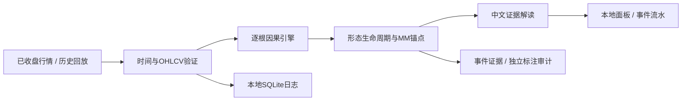

<div align="center">
<h1>Price Action Lens</h1>
<p>逐根读图，明确场景，让每条解读都有证据。</p>


[English](README.md) · **简体中文**

[介绍](#介绍) · [快速开始](#快速开始) · [架构](#架构) · [验证与限制](#验证与限制) · [参与](#参与与许可)
</div>

## 介绍
基于 [AI Agent Lens](https://github.com/roan-maverick/tradingview-indicator-for-ai-agents) 的原创 Python 研究扩展：顺序接收已收盘 K 线，识别一部分 Brooks 风格价格行为结构，输出中文证据、失效条件与 measured move 锚点。

**不是完整 Brooks 课程的自动化复刻，不负责下单，也不自带实时行情。** 上游 Pine 和 MIT 版权声明保留，见[原版README](docs/UPSTREAM_README.md)。[资料审计](docs/research/source_audit.md)区分实际读到的正文、仅有目录和未观看视频；[覆盖表](docs/COVERAGE.md)区分已实现、手工辅助及未实现。数值阈值都是工程近似，不是 Brooks 发布的官方算法。

### 观察系统有什么
- 双底/双顶候选及严格颈线突破确认，摆动点需等待右侧 K 线，不把确认信号画回过去冒充提前预测。
- 内包/外包 K 线、启发式区间突破与背景；区间高度、双底/顶高度 MM，手动 AB=CD 投射。
- 同一套逐根引擎用于历史回放与认证接入；SQLite 重启重建、行情时间陈旧提示、本地曲线和信号解释面板。
- 44张来源知识卡，事件附概念、反例、来源链接及不确定性；不是44个全部实现的检测器。
- ii/ioi、微通道、分类型缺口、EMA回测、紧区间/铁丝网、惊讶条/高潮候选、突破跟随/失败；H1/H2与三推生命周期是明确的工程近似。
- 默认回放只审查观察：原K线证据、单独标记的事后路径、固定日历抽样与空白人工标注表。不以策略盈亏代替解读正确性。
- `probability=null`：不把规则强度写成胜率。中文解释不依赖外部 LLM，也不需要 API key。

## 快速开始
Python 3.11+，仅用标准库。进入仓库根目录运行：

```bash
python -m unittest discover -s tests -v
python -m pa_lens replay examples/pa/synthetic_double_bottom.jsonl --out local_data/demo
python -m pa_lens mm --a 100 --b 110 --c 105
```
示例是**人工合成数据**，不是 SOXL 或收益证据。回放输出事件流水和 JSON 报告。第三方原始行情不随仓库再分发。

### 本地接入与面板
在自己的环境设置至少16字符的随机 `PA_LENS_TOKEN`，再运行：

```bash
python -m pa_lens serve --db local_data/lens.sqlite3 --port 8080
```
打开 `http://127.0.0.1:8080/`，在页面中输入 token，仅保存在页面内存。提交已收盘数据：

```bash
curl -X POST http://127.0.0.1:8080/bar \
  -H "Authorization: Bearer $PA_LENS_TOKEN" -H 'Content-Type: application/json' \
  --data '{"symbol":"SOXL","timeframe":"1","time":"2026-11-17T14:31:00Z","open":50.5,"high":50.8,"low":50.1,"close":50.4,"volume":1000,"source":"example"}'
```
这是**历史格式示例**，不是已经订阅实时数据。标准输入 `time` 为收盘时刻。`/webhook` 兼容上游 `ai-agent-lens/v1` 格式，仍要求 Bearer 认证；TradingView 不能直接设置该请求头；现在支持显式启用独立 query-secret 入口，见[接入说明](docs/LIVE_ADAPTER.md)，但未部署公网 HTTPS 中继。不要直接把开发 HTTP 服务暴露到公网。

`/health`、`/snapshot` 也要认证。RECENT 仅代表提交的时间戳接近现在，不等于实时行情质量已验证。服务活着不等于行情活着。

### 观察审计
```bash
python -m pa_lens.audit YOUR_SOXL.csv --open-time-minutes 1 --out local_data/observation-audit
python knowledge/kb.py search "双底"
```
输出包含私有原行情证据与事后路径，不要提交公开git。人工标注初始为空，准确率、precision/recall均未知。11月17日是已知案例，不能冒充盲测。`evaluate`仅保留为独立旧策略实验。

### 展示降噪
默认只看重点结构变化：优先级3、同形态/状态/方向15分钟冷却、同根合并一组；原始观察不删除。需要候选用`--display-min-priority 2`，不需冷却用`--display-cooldown-minutes 0`。这是显示设置，不是置信度/准确率。设置固定在日志中，变更请用新数据库，避免静默改写历史展示。

### 历史数据
支持标准 JSONL/CSV，以及文档化的 Alpaca 导出字段：`timestamp` 是一分钟 bar 开始时刻，适配器加一分钟转收盘时刻，feed 保留在来源标识中。单次回放只能是一条按时间排序的数据流；不静默排序、混合数据源或填造缺失价格。

### 可选实时适配
已实现 Alpaca 已收盘一分钟 REST 轮询与已保存 connector 响应桥接，见[连接步骤](docs/LIVE_ADAPTER.md)。已做有限轮次的真实 IEX 闭合条采集，见[实测证据](docs/reports/LIVE_CONNECTOR_VALIDATION.md)；近期 SIP 被权限拒绝，未部署独立常驻服务。新增9个概念的可判定子集，包括 MTR 发展、末旗候选、完整5分钟聚合，不冒充完整主观形态，见[精确定义](docs/STRUCTURES.md)与[v0.4验收](docs/reports/V04_VALIDATION.md)。

## 架构


| 目录 | 职责 |
|---|---|
| `pa_lens/core.py` | 数据契约、逐根规则、投射 |
| `pa_lens/service.py` | 认证、日志、重启恢复、健康状态 |
| `pa_lens/dashboard.html` | 本地曲线与解释面板 |
| `pa_lens/replay.py` | 数据加载与回放；旧策略实验独立保留 |
| `pa_lens/observations.py` / `advanced.py` | 闭合K线观察、因果结构生命周期 |
| `pa_lens/explanations.py` / `knowledge/` | 来源解释、反例与知识库 |
| `pa_lens/audit.py` | 观察审计与独立人工标注模板 |
| `tests/` | 因果性、时间、费用、API等回归测试 |
| `docs/research/` | 资料证据、设计与边界 |
| `docs/reports/` | 实际验证和已知局限 |
| `ai-agent-lens.pine` | 保留的上游指标 |

### 怎么扩展
先补概念卡：来源、背景、首次可知时刻、工程阈值、反例与测试，再写失败测试和规则。验证前缀一致性，更新覆盖表。同一批摆动点构成两个形态，不意味着两份独立概率证据。不直接复制有未来函数或许可不兼容的开源实现。

## 验证与限制
见[观察审计协议](docs/AUDIT_PROTOCOL.md)和[覆盖表](docs/COVERAGE.md)及[当前验证结果](docs/reports/OBSERVATION_VALIDATION.md)。旧[验证报告](docs/reports/VALIDATION.md)保留为v0.1历史策略实验，不是当前形态准确率。测试通过、后来涨跌和形态识别正确是三件事。

| 项目 | 真实边界 |
|---|---|
| 因果性 | 右侧确认完成后才能发布，不回填早期信号 |
| 实时接入 | 有限轮次 IEX 已实采；不代表全市场 SIP 或常驻运行 |
| 11月17日 SOXL | 先前已研究过，只能称已知案例，不是盲测 |
| 三个月 SOXL | 66个交易日历史逐根观察；固定日历样本仍需独立标注 |
| 费用 | 无逐笔报价/成交时属于成本情景假设 |
| 复权 | 连接器未暴露参数时必须标未验证 |
| 形态 | 部分启发式；H2和三推已扩展，完整MTR等仍未完成 |
| 成交 | OHLC不能确定同根路径，模拟不能写成实际成交 |

## 参与与许可
欢迎带反例、测试和来源许可说明的贡献。不要提交凭证、受限原始行情或未经证实的收益声明。不加入自动订单或账户访问。

MIT，保留[上游版权](LICENSE)。与 Al Brooks、Brooks Trading Course、TradingView、Alpaca、Robinhood 无官方关联。仅供研究学习，不构成投资建议，不保证盈利。
