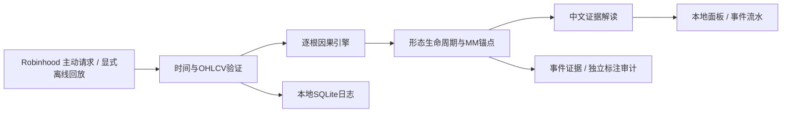

<div align="center">
<h1>Price Action Lens</h1>
<p>逐根读图，明确场景，让每条解读都有证据。</p>


[English](README.md) · **简体中文**

[介绍](#介绍) · [快速开始](#快速开始) · [架构](#架构) · [验证与限制](#验证与限制) · [参与](#参与与许可)
</div>

## 介绍
基于 [AI Agent Lens](https://github.com/roan-maverick/tradingview-indicator-for-ai-agents) 的原创 Python 研究扩展：顺序接收已收盘 K 线，识别一部分 Brooks 风格价格行为结构，输出中文证据、失效条件与 measured move 锚点。

**Robinhood MCP 主动取数 + 本地 PA 观察系统，不是交易执行器，也不是完整 Brooks 课程的自动化复刻。** 上游 Pine 和 MIT 版权声明保留，见[原版README](docs/UPSTREAM_README.md)。[资料审计](docs/research/source_audit.md)区分实际读到的正文、仅有目录和未观看视频；[覆盖表](docs/COVERAGE.md)区分已实现、手工辅助及未实现。数值阈值都是工程近似，不是 Brooks 发布的官方算法。

### 观察系统有什么
- 双底/双顶候选及严格颈线突破确认，摆动点需等待右侧 K 线，不把确认信号画回过去冒充提前预测。
- 内包/外包 K 线、启发式区间突破与背景；区间高度、双底/顶高度 MM，手动 AB=CD 投射。
- 同一套逐根引擎用于历史回放与认证接入；SQLite 重启重建、行情时间陈旧提示、本地曲线和信号解释面板。
- 44张来源知识卡，事件附概念、反例、来源链接及不确定性；不是44个全部实现的检测器。
- ii/ioi、微通道、分类型缺口、EMA回测、紧区间/铁丝网、惊讶条/高潮候选、突破跟随/失败；H1/H2与三推生命周期是明确的工程近似。
- 默认回放只审查观察：原K线证据、单独标记的事后路径、固定日历抽样与空白人工标注表。不以策略盈亏代替解读正确性。
- `probability=null`：不把规则强度写成胜率。中文解释不依赖外部 LLM，也不需要 API key。

## 快速开始
Python 3.11+。日线交易日历依赖 `exchange-calendars`，先安装固定版本依赖。进入仓库根目录运行：

```bash
python -m pip install -r requirements.txt
python -m unittest discover -s tests -v
python -m pa_lens replay examples/pa/synthetic_double_bottom.jsonl --out local_data/demo
python -m pa_lens mm --a 100 --b 110 --c 105
```
示例是**人工合成数据**，不是 SOXL 或收益证据。回放输出事件流水和 JSON 报告。第三方原始行情不随仓库再分发。

### 主动请求 Robinhood
需事先安装原 infra，并在 Codex 完成官方 Robinhood 连接授权。把 `RH_INFRA` 设为安装目录；本项目不自行登录，也不读取凭据文件。

```bash
python -m pa_lens fetch-robinhood --infra-root "$RH_INFRA" --symbols SOXL QQQ \
  --interval day --start 2026-08-17T00:00:00Z --end 2026-11-18T00:00:00Z \
  --db local_data/rh-daily-strict.sqlite3
python -m pa_lens poll-robinhood --infra-root "$RH_INFRA" --symbols SOXL \
  --interval minute --poll-seconds 30 --count 2 --db local_data/rh-minute-strict.sqlite3
```
以上默认严格。要探索未知插值数据才显式加 `--accept-unknown`，另用新数据库；输出仍是未知质量而非可靠交易信号。轮询是主动 getter，不是交易所推流。需要同进程面板时，设置本地 `PA_LENS_TOKEN` 后加 `--serve-port 8080`；不能另开 `serve` 和采集器共写同一个日志。

15分钟模式实际请求5分钟原始条，只有同一常规交易时段完整三根才生成一根，不跨日或补造缺桶。按收盘边界轮询可用：

```bash
python -m pa_lens poll-robinhood --infra-root "$RH_INFRA" --symbols SOXL \
  --interval 15minute --align-close --settle-seconds 10 --count 2 \
  --accept-unknown --db local_data/rh-15m-exploratory.sqlite3
```
这是有限两轮探索，不是daemon部署。初次立即取数，后续按边界加等待时间；供应商没有公开延迟SLA。每个进程一套周期和多只标的；不同周期进程使用不同数据库。

### Robinhood 原生18指标
当前指标解读默认使用 Robinhood 原生 EMA20 / RSI14，**缺失、过期或不匹配时明确不可用，不回退本地计算**。本地值保留为诊断，纯K线结构与历史事件不改写。all18 显式请求 EMA20，EMA9 可另行配置。支持全部18类、完整参数、多字段和 `series` / `latest` / `last:N`：

```bash
python -m pa_lens fetch-robinhood --infra-root "$RH_INFRA" --symbols SOXL \
  --interval 5minute --start 2026-11-18T14:30:00Z --end 2026-11-18T17:20:00Z \
  --accept-unknown --native-indicators all --native-output last:3 \
  --db local_data/rh-native-demo.sqlite3
```
这是固定历史窗口示例，不是当前报价。可用 `--native-config examples/native-indicators.json` 指定多组参数；`--native-window-start` 固定计算窗口起点。不同请求窗口可能产生不同EMA/MACD数值，不能拼接成当时已知的连续真值。原生15分钟不存在，需要另设 `--native-interval` 时必须明确其不同周期。

原生值带参数、bar时点、接收时点、来源质量/预热未知提示；负值保留，null不是0。MACD三列、通道三列、Supertrend两列、Pivot七列完整显示。单项错误/未定义不会隐去其它成功项。历史事件定位隐藏后来采集的原生值，避免前视。见[完整契约](docs/ROBINHOOD.md)和[实测证据](docs/reports/NATIVE_INDICATORS_V06_ACCEPTANCE.md)。

### 本地接入与面板
在自己的环境设置至少16字符的随机 `PA_LENS_TOKEN`，再运行：

```bash
python -m pa_lens serve --db local_data/lens.sqlite3 --port 8080
```
打开 `http://127.0.0.1:8080/`，在页面中输入 token，仅保存在页面内存。提交已收盘数据：

```bash
curl -X POST http://127.0.0.1:8080/bar \
  -H "Authorization: Bearer $PA_LENS_TOKEN" -H 'Content-Type: application/json' \
  --data '{"symbol":"SOXL","timeframe":"1","time":"2026-11-17T14:31:00Z","open":50.5,"high":50.8,"low":50.1,"close":50.4,"volume":1000,"source":"example"}'
```
这是**历史格式示例**，不是已经订阅实时数据。标准输入 `time` 为收盘时刻。`/webhook` 兼容上游 `ai-agent-lens/v1` 格式，仍要求 Bearer 认证；TradingView 不能直接设置该请求头。旧 query-secret 实验入口不应用于公网，也不是当前数据路径；不要将秘密放进 TradingView URL/消息。未部署公网 HTTPS 中继。不要直接把开发 HTTP 服务暴露到公网。

`/health`、`/snapshot` 也要认证。RECENT 仅代表提交的时间戳接近现在，不等于实时行情质量已验证。服务活着不等于行情活着。

### 观察审计
```bash
python -m pa_lens.audit YOUR_SOXL.csv --open-time-minutes 1 --out local_data/observation-audit
python knowledge/kb.py search "双底"
```
输出包含私有原行情证据与事后路径，不要提交公开git。人工标注初始为空，准确率、precision/recall均未知。11月17日是已知案例，不能冒充盲测。`evaluate`仅保留为独立旧策略实验。

### 展示降噪
默认只看重点结构变化：优先级3、同形态/状态/方向15分钟冷却、同根合并一组；原始观察不删除。需要候选用`--display-min-priority 2`，不需冷却用`--display-cooldown-minutes 0`。这是显示设置，不是置信度/准确率。设置固定在日志中，变更请用新数据库，避免静默改写历史展示。

### 历史数据
支持标准 JSONL/CSV，以及文档化的 Alpaca 导出字段：`timestamp` 是一分钟 bar 开始时刻，适配器加一分钟转收盘时刻，feed 保留在来源标识中。单次回放只能是一条按时间排序的数据流；不静默排序、混合数据源或填造缺失价格。

### 主动数据源与日线 swing
升级旧版请先读[迁移说明](docs/MIGRATION_V05.md)，不要复用旧代码身份的日志。
Robinhood 是当前主动取数路径，复用用户已安装的 [Robinhood trading infra](https://github.com/GordonBai/robinhood-trading-infra) 官方 Codex MCP transport，不复制 OAuth 凭据。股票历史、报价及原生技术指标三个只读工具在代码白名单内，不含账户或下单。分钟/5/10/30分钟/小时/4小时及日线使用明确粒度，不把日线伪装成分钟线。配置和运行命令见 [Robinhood 接入](docs/ROBINHOOD.md)。

**默认严格：`interpolated=true` 一律排除；字段缺失视为未知，也不进入形态分析。** 显式 `--accept-unknown` 才能探索未知质量数据，所有输出保留 `DATA_QUALITY_UNKNOWN`，`ready=false`。正成交量不能证明没有插值。实测近期分钟和日线缺该字段，所以严格模式不产生 PA；并非悄悄改用另一个供应商。

日线用 XNYS 交易日历，跨周末/假日连续分析，缺交易日则重置。供应商每日 UTC 日期标签转换为**下一 UTC 零点的保守可用时刻**，不是开盘时已知。开盘专用/5分钟聚合检测不用于日线。本地 EMA20、Wilder RSI14 和引擎均值 TR 分开展示其种子与预热；不冒充供应商技术指标；Robinhood 原生18指标另列来源和参数。形态优先级只是展示规则，不是胜率。

旧 Alpaca 数据导入、历史证据与显式兼容入口仍保留，但不作为默认生产路径，不会自动回退。既往 SIP 三个月回放不是 Robinhood 三个月分钟线验证。实测 Robinhood 8/17 分钟线全是插值，不可用于分析。见 [v0.5 原始验收结论](docs/reports/ROBINHOOD_V05_ACCEPTANCE.md)。独立常驻服务、无人值守可靠性仍未部署验证。

## 架构


| 目录 | 职责 |
|---|---|
| `pa_lens/robinhood.py` / `rh_runtime.py` | 只读白名单、主动获取、原始来源与质量 |
| `pa_lens/analytics.py` / `timeframes.py` | 本地指标、日线日历和连续性 |
| `pa_lens/core.py` | 数据契约、逐根规则、投射 |
| `pa_lens/service.py` | 认证、日志、重启恢复、健康状态 |
| `pa_lens/dashboard.html` | 本地曲线与解释面板 |
| `pa_lens/replay.py` | 数据加载与回放；旧策略实验独立保留 |
| `pa_lens/observations.py` / `advanced.py` | 闭合K线观察、因果结构生命周期 |
| `pa_lens/explanations.py` / `knowledge/` | 来源解释、反例与知识库 |
| `pa_lens/audit.py` | 观察审计与独立人工标注模板 |
| `tests/` | 因果性、时间、费用、API等回归测试 |
| `docs/research/` | 资料证据、设计与边界 |
| `docs/reports/` | 实际验证和已知局限 |
| `ai-agent-lens.pine` | 保留的上游指标 |

### 怎么扩展
先补概念卡：来源、背景、首次可知时刻、工程阈值、反例与测试，再写失败测试和规则。验证前缀一致性，更新覆盖表。同一批摆动点构成两个形态，不意味着两份独立概率证据。不直接复制有未来函数或许可不兼容的开源实现。

## 验证与限制
见[观察审计协议](docs/AUDIT_PROTOCOL.md)和[覆盖表](docs/COVERAGE.md)及[当前验证结果](docs/reports/OBSERVATION_VALIDATION.md)。旧[验证报告](docs/reports/VALIDATION.md)保留为v0.1历史策略实验，不是当前形态准确率。测试通过、后来涨跌和形态识别正确是三件事。

| 项目 | 真实边界 |
|---|---|
| 因果性 | 右侧确认完成后才能发布，不回填早期信号 |
| 主动接入 | Robinhood 真实历史/报价已取；未知插值必须显式探索，不承诺常驻运行 |
| 11月17日 SOXL | 先前已研究过，只能称已知案例，不是盲测 |
| 三个月 SOXL | Robinhood 日线66根可探索；旧SIP分钟回放与新源分开，不能互作覆盖证明 |
| 费用 | 无逐笔报价/成交时属于成本情景假设 |
| 复权 | 连接器未暴露参数时必须标未验证 |
| 形态 | 部分启发式；H2和三推已扩展，完整MTR等仍未完成 |
| 成交 | OHLC不能确定同根路径，模拟不能写成实际成交 |

## 参与与许可
欢迎带反例、测试和来源许可说明的贡献。不要提交凭证、受限原始行情或未经证实的收益声明。不加入自动订单或账户访问。

MIT，保留[上游版权](LICENSE)。与 Al Brooks、Brooks Trading Course、TradingView、Alpaca、Robinhood 无官方关联。仅供研究学习，不构成投资建议，不保证盈利。

### 原生优先的当前 PA 语境（v0.7）

fetch/poll 默认请求原生 EMA20、RSI14，计入64次请求上限；all18 会合并去重，
仍为18次。`--no-native-context` 可关闭自动请求，但绝不改用本地值。
要求标的、周期、bounds、复权、实际参数及有效收盘时间与最新K线一致；
EMA9 不代替 EMA20，5m 原生不冒充15m，派生15m原生语境明确不可用。
数值年龄与接收年龄分别显示；超过 max(120秒, 两根周期) 则过期，
日线48小时限制是保守阈值，休市也不会自动放宽。已知K线修订/迟到会阻止比较，
避免把未重算的首次close当成修订后价格。原生源质量及暖机仍未知。

纯价格结构独立输出。依赖本地均线的 ema_gap / ema_first_return 保留原始审计，
标为 LOCAL_DIAGNOSTIC，主分组解读不展示，降到最低优先级也不混入。
当前原生语境在读取快照时生成，显示生成时刻/接收时间，不逆写历史事件。
历史定位直接提示“未记录当时原生解读”，不拿后来返回的数据回填。新版本使用新库，
不会悄悄修改既有日志。

### 图上读数与 PA 标记
悬停、点按或 Tab 聚焦 K 线，可读取该根真实保存的 OHLC、周期及 UTC / 纽约时间。
金色标记显示当前列表筛选后可见事件的既有形态、状态、解释与质量；放在
**observed_at 可知时刻**，不回画到早先摆动锚点，也不新增买卖判断。
历史定位会同时隐藏后续 K 线和标记。日线提示分开显示交易日与下一 UTC 午夜的
保守可知时间，避免误差一天。Enter/空格读取，Escape 关闭提示。

### 实时终端与 Replay Dashboard 分开

`poll-robinhood --output tui` 提供行情、原生指标、PA观察、数据质量四区终端；加 `--count 2` 可做有界测试。`--output text` 保留完整可读明细，`--output jsonl` 保留机器接口。Replay Dashboard 专用于历史交互查看，不由终端默认启动。参见[终端用法与质量边界](docs/TERMINAL_MONITOR.md)。
