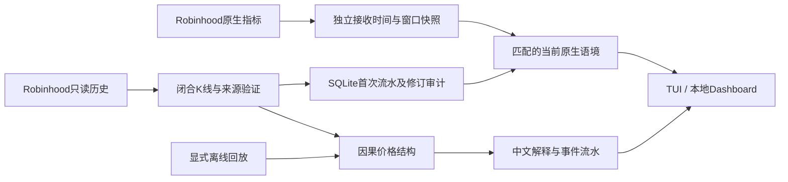

<div align="center">
<h1>Price Action Lens</h1>
<p>逐根读图，使用原生指标，让解读有据可查。</p>


[English](README.md) · **简体中文**

[介绍](#介绍) · [快速开始](#快速开始) · [指标与结构](#原生指标与价格结构) · [回放面板](#回放与-dashboard) · [架构](#架构) · [验证](#验证与限制)
</div>

## 介绍
基于 [AI Agent Lens](https://github.com/roan-maverick/tradingview-indicator-for-ai-agents) 扩展的 **Robinhood MCP 只读看盘系统**。逐根处理已闭合 K 线，识别部分 Brooks 风格 PA 结构，以中文说明证据与不确定性。

- **终端监控**：行情、原生指标、PA观察、数据质量四区，显示纽约时钟与行情新鲜度。
- **原生优先语境**：当前解读显示与最新收盘 K 线匹配的 Robinhood 指标及其可用状态。
- **价格结构**：双底/双顶、颈线确认、measured move、内外包、突破观察及有边界的启发式生命周期。
- **回放与核对**：因果事件流水、可重启 SQLite 日志、图上悬停读数与历史事件定位。
- **44张来源知识卡**，不是44个全部实现的检测器。`probability=null`，不编造胜率。

不是下单系统，不是完整 Brooks 课程复刻，也不是已验证盈利策略。代码白名单仅含股票历史、报价和技术指标读取，不访问账户/订单、不复制凭据、不自动切换数据源。保留上游 Pine 与 MIT 声明，见[原版README](docs/UPSTREAM_README.md)、[资料审计](docs/research/source_audit.md)和[覆盖表](docs/COVERAGE.md)。

## 快速开始
### 1. 准备环境
需要 **Python 3.11+**，在仓库根目录运行。建议独立虚拟环境，避免混用系统依赖。

```bash
python3 -m venv .venv
source .venv/bin/activate
python -m pip install -r requirements.txt
python -m unittest discover -s tests -v
```

主动获取行情还需要：
1. 可用的 `codex` 命令，以及**事先授权好的官方 Robinhood MCP 连接**。
2. 已安装兼容的 [Robinhood trading infra](https://github.com/GordonBai/robinhood-trading-infra)。当前适配器要求 `src/trading_execution/transport.py` 提供 `CodexMarketTransport`；不会替你安装 infra 或完成登录。
3. 在向导填写安装位置，或传 `--infra-root`。以下命令示例使用：

```bash
export RH_INFRA="$HOME/robinhood-trading-infra"
```

离线合成数据回放无需 Robinhood 授权。详见[接入契约](docs/ROBINHOOD.md)。

### 2. 推荐：交互式启动
```bash
python -m pa_lens wizard
```

macOS 可双击 [`Start-Monitor.command`](Start-Monitor.command)，用已有的 Python 环境启动向导。选择 `monitor` 持续监控（默认 NVDA、5m、常规时段、30 秒、10 轮），或选择 `swing` 单次扫描日线。两种模式都预览命令并等待确认。输入 `q`、EOF 或 Ctrl-C 可取消设置。向导需要交互式 TTY。[终端与向导说明](docs/TERMINAL_MONITOR.md)

### 3. 或直接运行有限轮数
```bash
python -m pa_lens poll-robinhood --infra-root "$RH_INFRA" \
  --symbols NVDA --interval 5minute --bounds regular \
  --poll-seconds 30 --count 2 --output tui \
  --db local_data/nvda-monitor.sqlite3
```

默认接收省略 `interpolated` 字段的合格 K 线，并记录 `INTERPOLATION_OMITTED` 溯源。显式 `true` 或格式错误的标记一律拒绝。加 `--strict-interpolation` 也会排除省略标记的记录。fetch/poll 的 `--accept-unknown` 已弃用，仅保留兼容。使用 `--output text` 查看完整内容，或用 `--output jsonl` 接入脚本。每个监控进程需要独立日志，代码或配置变化后可能需要新库。

TUI 时钟每秒刷新，**不代表每秒请求行情**。人类可读的当前时钟、拉取/接收、K线与事件时间均使用完整纽约日期和 **EST/EDT**；存储及 JSONL 仍为 UTC。时钟在走不等于报价更新。初始历史、保留旧bar与本轮新观察分开显示。`--align-close --settle-seconds 10` 让后续轮次按周期边界调度，首轮立即请求。它是 getter 轮询，不是交易所推流，也没有无人值守长期运行保证。

## 日线波段扫描

```bash
python -m pa_lens swing --infra-root "$RH_INFRA" --symbols SPY QQQ NVDA --output text
python -m pa_lens swing --input daily-bars.jsonl --focus-bars 25
```

在线扫描默认请求最近 250 个自然日的 XNYS 常规时段、拆股复权日线，重点显示最近 25 根交易日 K 线内的结构。离线 JSONL/CSV 接受已收盘的 `D` K 线，默认扫描文件内全部数据流，可用 `--symbols` 筛选。日志默认保存在内存中。报告提供市场语境、结构状态与参考价位，`probability=None`，仅供研究。终端默认输出文本，管道默认输出 JSONL。[波段扫描参数与输入格式](docs/ROBINHOOD.md#daily-swing-observations-and-local-indicators)

## 原生指标与价格结构
### 当前原生优先解读
支持的 Robinhood 盘中周期默认请求 **EMA20、VWAP、ATR14、RSI14 和经典 Pivot**。常规时段日线的 fetch/poll 与在线 swing 默认请求 **EMA20、ATR14、RSI14 和 MACD（12、26、9）**。可用 `--no-native-context` 跳过自动请求。

要求标的、周期、bounds、复权、实际参数与最新K线有效收盘时间匹配。EMA9 不替代 EMA20。缺失、部分失败、未定义、错误、不匹配或过期时明确不可用。数值年龄和接收年龄分别显示；盘中新鲜度阈值为 `max(120秒, 2×周期)`，日线按 XNYS 日历判断，留出收盘后两小时宽限期。已知修订/迟到会阻止拿未重算的首次close进行比较。原生源质量与暖机仍未知。

纯价格结构独立工作。本地 EMA20 / RSI14 / 均值TR仅用于诊断，不当替代。`ema_gap`、`ema_first_return` 保留审计，标为 `LOCAL_DIAGNOSTIC`，主分组不展示。当前原生语境在快照读取时生成；历史定位绝不把后来收到的指标回填过去。

### 全部18类、完整参数与多字段
```bash
python -m pa_lens fetch-robinhood --infra-root "$RH_INFRA" --symbols SOXL \
  --interval 5minute --start 2026-11-18T14:30:00Z --end 2026-11-18T17:20:00Z \
  --accept-unknown --native-indicators all --native-output last:3 \
  --db local_data/native-historical-demo.sqlite3
```

这是**固定历史窗口示例**，不是当前报价。`all` 显式请求 EMA20，合并默认语境请求，单批标的仍为18次。EMA9或多组参数可用 [`examples/native-indicators.json`](examples/native-indicators.json) 与 `--native-config` 配置。支持 `latest`、`last:N`、`series`；MACD、通道、Supertrend、Pivot保留所有列、负值与null。单项失败不会隐去其它成功项。

`--native-window-start` 固定计算起点。不同输入窗口可能改变 EMA/MACD，不能拼成历史时点真值。请求/返回参数、窗口、有效/接收时刻与质量均可见。**没有原生15m指标**：另行请求的5m原生值仍标5m，不填补15m PA语境。18类全部可访问，**不代表18类全部写成了形态规则**。详见[完整契约](docs/ROBINHOOD.md)。

## 回放与 Dashboard
### 离线回放
```bash
python -m pa_lens replay examples/pa/synthetic_double_bottom.jsonl --out local_data/demo
python -m pa_lens mm --a 100 --b 110 --c 105
python knowledge/kb.py search "双底"
```

示例是合成数据，不是SOXL或收益证据。`replay` 生成 JSON报告和事件流水，**不会自动生成HTML，也不是实时订阅**。输入必须是一条按时间排序的数据流；标准 `time` 为收盘/可知时刻，旧开盘时间格式需显式适配。不静默排序、补价或混合来源。

### 浏览器核对与 TUI 分开
终端监控默认不打开浏览器。已保存的离线 Replay Dashboard 是历史快照，不是实时看盘。若要采集时同时使用认证本地面板，设置自己的随机 `PA_LENS_TOKEN`（至少16字符），再给**同一个采集进程**加 `--serve-port 8080`。打开 `http://127.0.0.1:8080/`，在页面输入token。也可在没有采集进程占用时用 `serve --db ...` 打开兼容日志；不要两个进程共写一个数据库。

原生主摘要位于图表上方，完整证据可展开，本地诊断在末尾。悬停、点按、Tab聚焦可读取该根精确 OHLC、周期及 UTC/纽约时间。金点只对应**当前列表可见事件**，按 `observed_at` 可知时刻定位，不回画到早先锚点，也不新增买卖判断。历史定位隐藏后续K线、标记和当前原生语境。日线提示分开显示交易日与保守可知时间。Enter/空格读取，Escape关闭提示。

主展示默认优先级3、同形态/状态/方向15分钟冷却、同根合为一组。`--display-min-priority 2` 包含候选；`--display-cooldown-minutes 0` 关闭冷却。原始事件保留。这是编辑性展示规则，不是置信度。

## 数据质量与时间边界
| 项目 | 契约 |
|---|---|
| 插值 | 字段省略默认接收并记录溯源；显式 true 或格式错误一律排除。严格模式也排除省略。 |
| 修订/迟到 | 保留首次事件流水，将变化或迟到数据隔离并降低就绪状态，不静默重算历史。 |
| 日线swing | XNYS日历，跨周末/假日连续，缺预期交易日则重置。日线采用 XNYS 实际收盘时间，常规为 **16:00 ET**，计划提前收盘日为 **13:00 ET**。 |
| 派生15m | 原生5m输入，同日完整连续三根、纽约09:30对齐；不补缺桶、不跨日、不伪造原生15m。日线与派生15m仅regular。 |
| 历史覆盖 | 分块请求不保证历史可用；此前8月分钟线探测全为插值，不可分析。 |
| 数据源 | Robinhood默认主动取数；旧Alpaca导入和显式TradingView/Alpaca接口只作兼容，不自动回退。 |
| 公网 | 本地开发HTTP服务，不是安全公网TradingView中继；不要把秘密放到TV URL/消息，也不要直接暴露服务。 |

`/health`、`/snapshot` 要认证。RECENT只表示时间戳接近当前，不证明数据质量。OHLC不能确定同根路径、实际成交或盈利。[迁移背景](docs/MIGRATION_V05.md) · [观察审计协议](docs/AUDIT_PROTOCOL.md)。

## 架构


| 路径 | 职责 |
|---|---|
| `wizard.py` / `terminal_monitor.py` | 结构化启动、终端显示与独立时钟 |
| `robinhood.py` / `rh_runtime.py` | 只读取数、归一化、覆盖与质量 |
| `provider_indicators.py` / `native_runtime.py` / `native_interpretation.py` | 原生契约、独立快照、仅当前语境 |
| `core.py` / `observations.py` / `advanced.py` / `structures.py` | 因果结构近似与生命周期 |
| `analytics.py` / `timeframes.py` | 本地诊断与日线时间语义 |
| `service.py` / `dashboard.html` | 日志、认证、健康状态与浏览器核对 |
| `replay.py` / `audit.py` | 回放、观察审计与分开的旧策略实验 |
| `knowledge/` / `docs/research/` | 来源卡、反例与阅读/覆盖边界 |
| `tests/` / `docs/reports/` | 回归测试与实际验证报告 |
| `ai-agent-lens.pine` | 保留的上游TradingView指标 |

表中 Python 模块位于 `pa_lens/`。

## 验证与限制
最新验收报告各自注明日期和范围：
- [全workspace审查](docs/reports/GLOBAL_REVIEW.md)：317项测试，316通过/1可选Chromium跳过，知识库、构建与合成回放检查通过。
- [向导、独立时钟与纽约时间修正](docs/reports/INTERACTIVE_CLOCK_ACCEPTANCE.md)：NVDA有限轮数实测；最终时间修正记录316项测试，315通过/1可选跳过。
- [图表hover与独立TUI](docs/reports/HOVER_TUI_ACCEPTANCE.md)：实际回放hover及SOXL盘后有限轮询，注明GUI访问限制。
- [原生优先v0.7](docs/reports/NATIVE_FIRST_V07_ACCEPTANCE.md)：默认EMA20/RSI14真实路径与当前解读边界。
- [原生18类实测](docs/reports/NATIVE_INDICATORS_V06_ACCEPTANCE.md)及[浏览器验证](docs/reports/NATIVE_INDICATORS_V06_BROWSER.md)。
- [Robinhood v0.5](docs/reports/ROBINHOOD_V05_ACCEPTANCE.md)：更早的数据源迁移、日线/15m与修订验证。

**不要混淆窗口：**最终按用户要求完成的SOXL日线回放是 **2026-08-18–2026-11-17，共65个交易日**。更早v0.5实验从 **8月17日开始，共66日**，包含SOXL和QQQ。旧Alpaca SIP分钟回放又是另一套数据，不能证明Robinhood分钟历史覆盖。原始行情与私有回放文件不公开再分发。

11月17日已先前看过，只能称已知案例，不是盲测。测试通过、前缀一致性是软件行为证据，不是独立人工标注准确率或盈利证明。准确率、precision/recall仍未确立，重叠事件也不是独立预测。[覆盖表](docs/COVERAGE.md)明确主观/未实现部分。[v0.4验证](docs/reports/V04_VALIDATION.md)及[v0.1策略实验](docs/reports/VALIDATION.md)只是历史报告，不是当前准确率。有限轮询不等于无人值守保证；此前临时supervisor超时未按计划停止的问题，在v0.7报告中明确披露。

## 贡献
先补来源卡与反例，写失败测试，再实现、验证前缀一致性并更新覆盖。不要引入不兼容许可、未来函数、凭据或受限原始行情。不加入自动订单或账户访问。

## 许可与免责声明
MIT，保留[上游版权](LICENSE)。与 Al Brooks、Brooks Trading Course、TradingView、Alpaca、Robinhood 无官方关联。仅供研究学习，不构成投资建议，不保证盈利。
